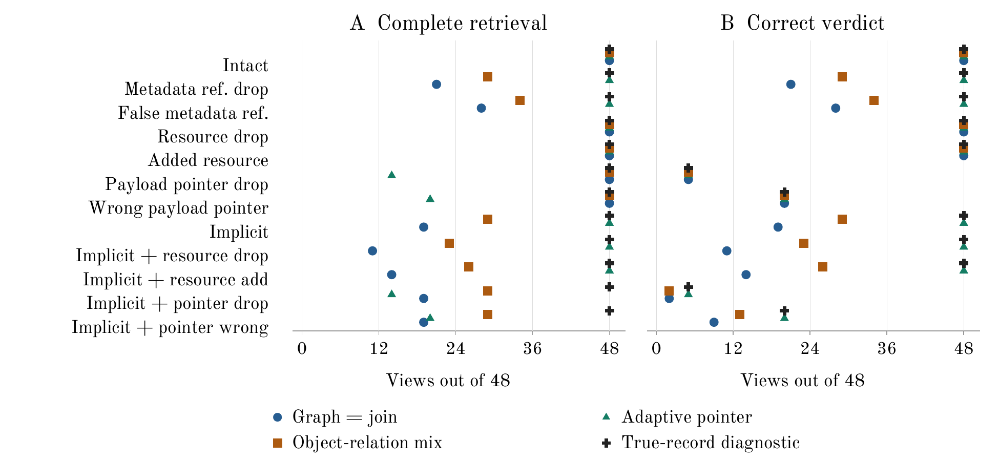

# Information Access Assumptions in Synthetic Evidence Retrieval

Author identification omitted from this public-snapshot derivative.

## Abstract

An oversight monitor may need several related log records to assess one action, yet can read only a few detailed records. We ask when visible links help it retrieve all required evidence, and whether complete retrieval ensures a correct verdict. We compare metadata-based selection with sequential payload reads in synthetic workflows, separating retrieval from two deterministic checker contracts. The workflows use private-ledger labels and contain no strategic agents or experimental model calls. A 24-family comparison and a repetition on 192 fresh families test access and pointer faults. In the repetition's 4,608 paired views, graph and equivalent joins completed 2,989 evidence sets, sequential traversal 3,594, and an object-first mixture 3,797. A separate 96-family object-collision study reduced mixture completion to 110/192 versus graph's 192/192 under explicit references and fully retained colliding IDs. Fixed relation reservation regressed overall; a matched topology study found conditional gains but also checker errors despite complete retrieval. This small comparative audit connects to Track 4 through the dependence of oversight on altered logs. It identifies access assumptions and baseline failure modes, without establishing methodological novelty, general superiority, or real-world swarm safety.

## 1 Introduction

This audit separates graph representation from equivalent joins, sequential access from batch selection, and evidence coverage from checker agreement. Link faults and object/topology variations expose assumptions behind each result. Track 4, Multi-Agent Oversight and Control [4], motivates this log-integrity question. The comparison does not test strategic agents, collusion detection, or operational oversight.

<!-- page -->

## 2 Evidence and Checker Contracts

### 2.1 A four-record example

Consider P (produce), T (transform), A (authorize) and C (commit), with dependencies C -> A -> T -> P. C is the **anchor**, the action being checked; {C,A,T,P} is its true required set. A **read budget** of four permits four distinct detailed records, including C. Reading an unrelated record uses a slot. This is an illustrative example, not an experiment.

**Metadata** is the catalog information supplied before selection: event, actor and object IDs, timestamps, references, resources and payload sizes in the original studies. A **payload** is a detailed 512-byte record obtained by spending one read. It contains the event ID, stage, value, authorization flag and previous_receipt pointer. A metadata reference suggests a relation before C is read; C's payload pointer separately asserts a predecessor. These fields are corrupted independently: the catalog link can be wrong while the payload dependency is intact, or vice versa.

A private ledger retains actual parents and labels for evaluation; selectors and checkers cannot consult it. The original model has four stages and three actors in stage order A,B,C,B, without strategy, and exposes a full catalog including true predecessors. Section 7 instead exposes ID/size metadata and requires k=4 or 8 records.

### 2.2 Two different checker rules

The **fixed-stage checker**, used in Sections 4-6, follows payload pointers from commit through authorize, transform and produce. Only a valid observed chain yields normal for Boolean approved=true or violation for approved=false. Missing or repeated records, wrong IDs/stages, unequal compared values, invalid approval or a non-null final pointer yield unknown. Value mismatch is not a violation. In the example, reading all four records cannot resolve A's missing pointer to T: retrieval is complete, but this checker abstains.

The **observed-closure AND checker**, used only in Section 7 and Appendix E, has no four-stage template. Starting from the anchor, it recursively resolves every asserted prerequisite among the read payloads. If any required reference is missing or invalid, it returns unknown. Otherwise all approvals must be true for normal; any false approval yields violation. It ignores extra records outside this observed closure. A redirected reference can therefore replace a true dependency with a distractor even when all true records were read. This is a different checker and fault model, not a new outcome from the earlier experiments.

### 2.3 What the outcomes mean

**Complete** means the selected set contains every privately required record. **Correct** means normal or violation agrees with the private label. **Unknown** means the checker cannot decide; it is distinct from an incorrect verdict. A complete set can still yield unknown or an incorrect verdict, depending on the checker. The original true-record diagnostic supplies the required set. Section 7 separates this oracle from a 32-record full-catalog diagnostic; neither is a feasible selector.

<!-- page -->

## 3 Selection and Evaluation

### 3.1 Batch and sequential access

Original-study methods read four distinct payloads including the anchor. Random, recent, object-ID and resource-time baselines use metadata rankings with recency fallback. Reference join follows past metadata references. Relation graph materializes reference and shared-resource relations and ranks candidates by deterministic shortest paths. Relation join computes the same neighbors on demand: a controlled implementation comparison with the same information.

Adaptive pointer reads the anchor, then discovers each next ID inside the preceding payload. It requires a matching payload ID and an unseen, public, strictly earlier target; otherwise one recency batch fills the remaining budget. Approval, phase and value do not guide selection. Object-relation mix first selects earlier records matching the anchor's object ID, then fills remaining slots from join's ranking. It is not told whether object IDs are reliable.

The reader rejects nonpublic IDs, duplicates and excess reads; it is not hostile-code isolation. Batch methods choose all IDs before one round; sequential discovery uses up to four dependent rounds. Equal read counts therefore permit different information at selection time. Catalog/query traffic is also charged. Exact pointers are a generator assumption without authentication or a trusted logger.

### 3.2 Families and paired comparisons

A **family** is one independently seeded unit used to generate matched observations. For the original comparison, each family contributes two separately generated background settings crossed with twelve fault conditions: 24 views. Thus 24 families produce 576 views, not 576 independent samples. Methods share the same ledger, query and corruption within each view. Backgrounds of 8 and 24 workflows are generated separately; comparing them is not a causal load intervention or evidence of scale-up robustness.

Conditions alter metadata references/resources or payload pointers separately, including an implicit regime without metadata references. Methods share payload corruption. Appendix F gives rates and target rules. Development and evaluation seeds are separate. Intervals use 2,000 paired family-bootstrap resamples, preserving within-family dependence; they describe the fixed simulator/grid, without multiplicity correction or a population guarantee. Percentage-point differences always state the subtraction order.

### 3.3 Relation to prior work

Wang et al. [1] study budgeted supporting-span retrieval on ISETrace, which also contains execution-grounded synthetic trajectories. Candidate matching and synthetic data are not our novelty claims. We vary access, signal integrity and checking without reproducing their learned retrievers. NoDoze [2] addresses provenance-based alert triage, and Hub Forensics [3] analyzes redacted traces; neither supplies comparable detection results here. Their source-review limits are retained with the references and Appendix F.

<!-- page -->

## 4 Original Comparison

### 4.1 Retrieval and abstention

Table 1 separates retrieving evidence from interpreting it in the original 576-view comparison (24 families). Graph and join returned identical IDs/order throughout. With exact payload pointers, adaptive retrieved and correctly checked 384/384 views despite metadata faults, as expected. The preserved pilot had omitted this sequential baseline despite exposing its pointers.

Table 1. Fixed-stage checker outcomes. Current counts use 576 views from 24 families; the last column uses a separate, previously inspected 192-view pilot grid. Complete, Correct and Unknown are defined in Section 2. Unknown is an abstention, not a false verdict.

| Method | Complete /576 | Correct /576 | Unknown /576 | Historical complete /192 |
| --- | ---: | ---: | ---: | ---: |
| Random | 60 | 52 | 524 | 20 |
| Recent | 120 | 94 | 482 | 32 |
| Object ID | 276 | 208 | 368 | 104 |
| Resource time | 120 | 94 | 482 | 38 |
| Reference join | 332 | 248 | 328 | 71 |
| Relation graph | 371 | 273 | 303 | 94 |
| Relation join | 371 | 273 | 303 | 94 |
| Adaptive pointer | 452 | 434 | 142 | 192 |
| Object-relation mix | 439 | 325 | 251 | 147 |
| True-record diagnostic | 576 | 434 | 142 | 192 |

Mix beat graph in 68 views, lost in none and tied in 508. Adaptive had 161 wins, 80 losses and 335 ties. Its graph-relative losses split into 42 pointer-drop and 38 wrong-pointer views, where broken or off-chain dependencies exhaust the budget. These differ from all 124 adaptive failures.

Among 192 views assigned to pointer-fault conditions, 142 actually had damaged true-chain pointers and 50 retained an intact true chain. Adaptive retrieved 68 complete sets and gave 50 correct verdicts. The true-record diagnostic retrieved all 192 sets but also gave only 50 correct verdicts, with 142 unknowns. No method produced a false normal or false violation in this restricted grid; the abstentions follow the fixed-stage contract.

Adaptive minus graph was +14.06 pp [8.16,19.97]; mix minus graph was +11.81 pp [5.90,18.58], using 24 paired family means. These describe this simulator/grid, not universal rankings. The pilot replay is a compatibility check (Appendix F). Sections 5-6 test repetition and object linkage.

<!-- page -->

## 4 Original Comparison continued

### 4.2 Which signal is damaged

Figure 1 shows why retrieval and checking must be reported separately. Each row is an assigned fault condition; left and right panels share the same 48 views. With intact metadata references, graph/join and mix retrieve all 48 required sets even in pointer-fault rows. Their correct-verdict counts still fall because the checker follows payload dependencies. Without metadata references, resource loss or collisions can also prevent retrieval.



Figure 1. Left: Complete; right: Correct, under the fixed-stage checker. Horizontal axes count views out of 48 (24 families times two separately generated backgrounds). Colors and marker shapes identify methods; vertical offsets only separate overlapping points. Implicit means no metadata references. Metadata reference faults and payload pointer faults affect different fields. The diagnostic always receives the true set; its correct-count shortfall is abstention. Across the four pointer-fault rows, 142/192 assigned views have actual true-chain damage. This figure uses only the original evaluation.

### 4.3 Equal read counts are not equal access costs

Each feasible selector reads four 512-byte payloads, a 512-byte query and the full catalog: mean total input 20,074.667 bytes. Exact-pointer traversal needs four dependent payload rounds versus one batch. Assuming 1 ms per payload round gives 4 versus 1 ms of waiting, not a measured service latency. Graph construction, indexing, sorting and catalog transmission remain separate work; the complete cost table and 0/1/10 ms scenarios are in Appendix F.

The comparison therefore tests an access contract as well as a ranking rule. Sequential selection can exploit a pointer that a batch selector has not read; metadata can preserve retrieval when those pointers break. Complete retrieval alone cannot repair a damaged pointer under the fixed-stage checker. The next studies test whether the observed ranking persists and which metadata assumptions sustain it.

<!-- page -->

## 5 Repetition on Fresh Families

The repetition fixed 192 fresh families before execution, using the same generator, nine selectors, diagnostic, twelve conditions, two backgrounds and read contracts. Its 4,608 paired views are reported separately from the original 24-family holdout, without pooling or outcome-dependent sample-size changes. Each family contributes one mean across 24 views; intervals resample the 192 paired family differences.

Table 2. Complete counts in the original and repeated studies, repeated Correct counts, and repeated completion differences. Denominators are 576 original and 4,608 repeated views. Positive differences favor the named selector over graph; intervals are 95% family-bootstrap intervals (2,000 resamples). All methods remain in the saved aggregate.

| Selector | Original /576 | Repeat /4608 | Correct /4608 | Selector minus graph pp [95% CI] |
| --- | ---: | ---: | ---: | --- |
| Object ID | 276 | 2592 | 1972 | -8.62 [-13.72, -3.10] |
| Graph = join | 371 | 2989 | 2217 | 0.00 [0.00, 0.00] |
| Adaptive pointer | 452 | 3594 | 3490 | 13.13 [11.26, 15.00] |
| Object-relation mix | 439 | 3797 | 2850 | 17.53 [15.41, 19.88] |

Graph and join still select identical records. Adaptive gains +13.13 pp [11.26,15.00] over graph; mix gains +17.53 pp [15.41,19.88]. Their interval widths shrink from 11.81 to 3.73 pp and 12.67 to 4.47 pp. The mixture's descriptive rank now exceeds adaptive's, unlike the original sample. More families improve precision within the generator, not external validity or universal ranking.

Adaptive completes all 3,072 exact-pointer views. Among 1,536 pointer-fault-assigned views, 1,118 true chains are damaged and 418 intact; the true-record diagnostic abstains exactly on the damaged chains. Adaptive has 1,275 wins and 670 losses against graph. Mix has 808 wins and no losses under the original object-ID model.

That last result motivates the next experiment. Stable-object ledger/query pairs number 19/48 originally and 186/384 in repetition. In the original grid, object IDs are either constant throughout a workflow or different at every stage. The object-ID baseline also succeeds through recency in four additional original pairs, so successful retrieval does not count stable objects. Testing collisions and partial linkage is more informative about this assumption than simply enlarging the same sample again.

All background-specific comparisons and eleven prespecified fault contrasts remain in the aggregate. No selector, read budget or cost definition changed between the two studies. Separate seed ranges, execution locks, independent saved-artifact checks and deterministic reproduction are recorded in Appendix C.

<!-- page -->

## 6 Object Linkage and Fixed Reservation

A separate 96-family study crosses visible versus absent metadata references, unique versus four-bucket colliding object IDs, and per-record retention p=1/0.5/0. Here p is the retained fraction in expectation. Unretained fields receive distinct opaque per-event tokens, without treating missing IDs as equal. Masks include the anchor and are nested and paired. Payload pointers remain exact; truth and selectors are unchanged.

Table 3. Complete counts per 192 views (96 families times two backgrounds), with Mix minus graph in percentage points. Intervals resample 96 paired family means. Positive values favor mix. Adaptive pointer and diagnostic complete 192/192 in every row; graph equals join. Explicit means metadata references are present, implicit means absent.

| Reference | Namespace | p | Graph /192 | Mix /192 | Mix minus graph pp [95% CI] |
| --- | --- | ---: | ---: | ---: | --- |
| Explicit | Unique | 1 | 192 | 192 | 0.00 [0.00, 0.00] |
| Explicit | Unique | 0.5 | 192 | 192 | 0.00 [0.00, 0.00] |
| Explicit | Unique | 0 | 192 | 192 | 0.00 [0.00, 0.00] |
| Explicit | Collision | 1 | 192 | 110 | -42.71 [-48.96, -36.98] |
| Explicit | Collision | 0.5 | 192 | 121 | -36.98 [-44.27, -30.21] |
| Explicit | Collision | 0 | 192 | 192 | 0.00 [0.00, 0.00] |
| Implicit | Unique | 1 | 60 | 192 | 68.75 [62.50, 75.00] |
| Implicit | Unique | 0.5 | 60 | 84 | 12.50 [8.33, 17.19] |
| Implicit | Unique | 0 | 60 | 60 | 0.00 [0.00, 0.00] |
| Implicit | Collision | 1 | 60 | 110 | 26.04 [18.23, 33.85] |
| Implicit | Collision | 0.5 | 60 | 50 | -5.21 [-11.46, 0.52] |
| Implicit | Collision | 0 | 60 | 60 | 0.00 [0.00, 0.00] |

Under explicit references and full collision, 155/192 views contain earlier same-ID distractors. Object matches consume slots before join, reducing mix to 110/192 versus graph's 192/192: -42.71 pp [-48.96,-36.98]. With explicit metadata references, unique partial retention preserves mix completion at 192/192 through fallback; implicit unique partial retention gives 84/192. Partial collision gives mix 121/192 with explicit references; the implicit/partial-collision difference interval includes zero. Projection generation is outside selector timing.

A fixed reservation then protects the anchor and two relation-ranked slots, using an object match or join fallback for the last slot. On another 96 families it completes 1,535/2,304 versus mix's 1,626: -3.95 pp [-5.16,-2.82]. Explicit partial collision improves from 120/192 to 137/192, but full collision remains 113/192 for both, and implicit unique/full retention falls from 192/192 to 109/192. Reservation is not a general remedy. Appendix D retains all conditions, uncertainty and costs.

<!-- page -->

## 7 Matched Chains and Forks

The final study asks how reachability changes when dependencies branch. It uses the observed-closure AND checker from Section 2, not the earlier fixed-stage checker. On 96 fresh families, a chain and an AND fork/join share 32 candidate IDs, private required membership and approvals, and read budgets B=4/8/12. The required set has k=4 or 8 records; the fork has two branches sharing a root. Metadata exposes only ID and size. Breadth-first pointer traversal is compared with blind selection; one anchor reference is intact, null, or redirected to a background leaf with no prerequisites (Appendix E). Appendix E gives the full design and all 18 primary contrasts.

When B covers k and references are intact, traversal completes for both structures, as predicted; B<k makes completeness impossible. At k=4/B=12, null faults give fork 21/96 versus chain 3/96; false-leaf faults give 20/96 versus 2/96. Both fork-minus-chain differences are +18.75 pp [11.46,27.08]. At k=8/B=12, null faults give 2/96 versus 0/96, +2.08 pp [0.00,5.21], while false-leaf completion is zero for both. All 18 blind fork-minus-chain completion differences are zero; blind completion itself need not be zero. Branch cuts and edge counts differ: these conditional effects do not isolate topology from fault severity. An empirical all-zero bootstrap interval does not establish population zero.

Retrieval and verdicts diverge more sharply here. With false-leaf references, the full-catalog diagnostic reads all true records yet follows the altered closure: it falsely declares violation in 50/96 true-normal cases per topology/k. On true violations it falsely declares normal in 46/96 chain cases, versus 18/96 fork cases at k=4 and 19/96 at k=8. The true-set oracle reads only the required set, so damaged references instead yield unknown and no false verdicts. These are distinct information/checker contracts, not evidence that the original checker also made these errors.

## 8 Conclusion

Across the studies, retrieval performance depends on what a method can see before each read and which links remain reliable. Sequential discovery succeeds under intact pointers but costs dependent rounds; metadata can rescue retrieval when those pointers break. Object-based prioritization benefits from stable identity, loses evidence under collisions, and is not generally repaired by reserving two relation slots. Matched forks preserve more reachable evidence in some tested fault/budget settings, with limited gains for larger required sets.

Complete retrieval is an evidence-coverage criterion, not a guarantee of correct checking. The fixed-stage checker abstains on damaged chains; the observed-closure checker can accept a misleading dependency even with every true record available. Evaluators should specify metadata available before selection, pointers revealed by paid reads, fields faults may alter, and checker rules for unresolved or misleading dependencies; report coverage, errors and abstentions separately. These small synthetic workflows, full catalogs and restricted faults establish neither real-world swarm safety nor a general method ranking. Strategic corruption, authentication and operational-scale evaluation remain untested.

<!-- page -->

## References

[1] Wang, Y., Ju, J., Zhang, J., Sun, Z., Duan, Y., Zheng, M., and Cai, T. (2026). When Does Execution Provenance Help Agent Memory Retrieval? arXiv:2609.25913v1. https://arxiv.org/abs/2609.25913v1

[2] Hassan, W. U., Guo, S., Li, D., Chen, Z., Jee, K., Li, Z., and Bates, A. (2019). NoDoze: Combatting Threat Alert Fatigue with Automated Provenance Triage. Network and Distributed System Security Symposium. https://doi.org/10.14722/ndss.2019.23349

[3] Nakasaki, S. (2026). Early Flags for Multi-Agent Coordination Hubs in Redacted Swarm Traces. Swarm Hub Forensics repository report, commit 7d4ca7ad736b4d325b38e09ef32bc4d4693990ae. https://github.com/yema7582-code/swarm-hub-forensics/tree/7d4ca7ad736b4d325b38e09ef32bc4d4693990ae

[4] Apart Research (2026). Swarm Alignment Hackathon: Research tracks, guidelines, and submission requirements. Official page, checked November 8, 2026. https://apartresearch.com/sprints/swarm-alignment-2026

[5] Apart Research (2026). Apart Research hackathon submission template. Google document, modified November 4, 2026; DOCX exported for this draft on November 7, 2026. https://docs.google.com/document/d/1_1_27EyZriMlc8n8EBE2YScaeyMjm-8xjR097nmHXAE/edit

### Source scope

The Wang comparison uses the abstract, Sections 3-5 and 9, and Appendix G of version 1; later versions were not reviewed. Its code, dataset, and reported experiments were not reproduced. The NoDoze comparison uses the official abstract and PDF title/abstract and introductory material; its evaluation was not independently checked. The Swarm Hub Forensics comparison uses the pinned report and static implementation review recorded in the repository. No external results are combined with our denominators.

The private formatted manuscript used the official template [5] for structure and typography; that template and formatted artifact are not distributed in this Markdown snapshot. The event-specific requirements [4] permit eight main-text pages, excluding references and appendices, and require a 150-250-word abstract, author information, and a limitations and ethics appendix.

<!-- page -->

## Appendix A Limitations and Dual-Use / Ethical Considerations

The experiment uses synthetic identifiers, workflows, approvals, and payloads, not private conversations, credentials, or live infrastructure. The original grid's labels and zero incorrect verdicts establish neither AI harm prevention nor deployment safety.

Original-grid limits include a four-record target, full catalog, visible true parents, fixed payload size, one query per ledger and binary object stability. Object stress adds independent retention and four-bucket collisions. A,B,C,B labels three actors without interaction; backgrounds are not a load intervention. Resource sharing lacks semantics, and faults omit correlated failures, consistent forgery and compromised loggers. The two checker contracts are defined in Section 2.

Knowing required links could aid investigation or concealment. This toy study neither demonstrates operational evasion nor certifies a monitor; other access/trust models were not evaluated.

### Research chronology and prior work disclosure

The event requires prior-work disclosure [4]. Private organizer communications are excluded from this snapshot; they are not publicly inspectable evidence here. An exact eligibility boundary or project-specific approval is not established by this release. Times below are November 7, 2026, Asia/Seoul (UTC+09:00), unless stated otherwise.

November 5-6 literature notes, planning, and an optional Discord reader were preparation work. SWARM-007 fixed its design at 01:37:03 (f9f4de8), then implemented and tested the simulator. Development, evaluation, and reproduction began at 01:44:22, 01:44:31, and 01:45:30. Later blank-line cleanup preserved ASTs and received a new lock and matching reproduction. Execution hashes identify code initially run before its code commit.

SWARM-009 fixed its design at 14:57:22 (3f56b55), committed implementation as fb30a5f, and froze 15 source/config/test files. Development, fresh evaluation, historical replay, and reproduction ran at 15:03-15:04 without source or parameter changes. SWARM-010 drafted the report that evening; SWARM-013/014/015 revised documents on November 7-8. Later experiments are dated in Appendices C-E.

### Contributions and LLM Usage Statement

The author selected the topic and scope and authorized the pilots and follow-up experiments. Codex conducted literature review, developed the protocol and code, ran tests and experiments, analyzed outputs, and drafted this report. The author personally reviewed the research content and contribution description but did not rerun the code or exhaustively reverify numerical results and cited originals. This personal review does not constitute independent reproduction or exhaustive scientific validation. No LLM was an experimental agent or judge. Saved-artifact checks and document QA were completed, not independent scientific validation.

<!-- page -->

## Appendix B Code, Data, and Reproducibility

The research used Python 3.13.1's standard library on macOS 26.6.2, arm64. SWARM-009 passed 36 tests before execution was locked. Evaluation and reproduction matched five deterministic files: config.json, latent.jsonl, episodes.jsonl, results.jsonl, and summary.json. Timing and manifests are not byte-identical targets. The document builder has separate rendering dependencies.

Source, configs, aggregate summaries, and adapted protocol descriptions are included in this snapshot. SWARM-007 uses development/evaluation seeds 101-106/1001-1024; SWARM-009 uses 201-206/2001-2024. Each evaluation has 24 seed families; historical replay adds no new independent units.

Public snapshot: https://github.com/sinbumu/swarm-evidence-retrieval-audit . Source, configurations, supplied aggregates and this adapted manuscript are included; the code-only MIT license does not cover the manuscript, data or figures. The separate private origin contains the original Git history and excluded evidence. Executable snapshot fb30a5f and result snapshot f2e3236 are private-origin identifiers, not reachable commits in this snapshot. Raw episodes, timing observations, original locks, private keys, source snapshots and audit inputs are excluded. Source commit/file hashes alone do not prove historical freezing or preregistration. Public GitHub is optional under the event rules [4].

Historical execution commands are omitted from this public derivative. The unchanged runners depend on omitted inputs and, for topology, unavailable private Git ancestry and enforced time/attempt gates. Consult the evidence-availability guide before interpreting executable code as a reproduction package.

Historical command block omitted; no execution was performed for this snapshot.

The expected SWARM-009 evaluation SHA-256 hashes are:

```text
results.jsonl
245825c141be9bd8a2bf230efbc173523a0ce31674663e1ae283321f3ae5d9d7
summary.json
386339ebcefa4698525a5bad672024c0c75266327e7c13966b81fa4dc9480277
```

Table 1 and Figure 1 use reports/swarm-009-summary.json and local runs/SWARM-009/eval-v1/ results. Historical values use historical-v1/; Table 8 also uses eval-v1/performance.jsonl. The tracked summary retains condition counts, paired intervals, fault contrasts, costs, and diagnostic outcomes. The original private protocol contains the full pilot; the included configs preserve the complete background/condition grid. The public evidence-availability guide maps included files to claims and verification limits.

<!-- page -->

## Appendix C Follow-Up Protocols and Reproduction

SWARM-016 ran on November 8, 2026, Asia/Seoul (UTC+09:00), after the earlier report. Repetition design/config was committed as ab9deb9, implementation as 7c7421b; object-stress design as ce4518b and implementation as b2375c9. Protocol snapshots and execution locks precede evaluation. Development, evaluation, and reproduction began at 04:42:09/04:42:21/04:43:05 for repetition and 04:50:25/04:50:41/04:51:16 for object stress; exact UTC times are in private saved manifests and a verification receipt, both excluded from this snapshot. No prior activity is redated.

Repetition used 192 evaluation families; object stress used 96 distinct families. Their development seeds were separate from evaluation and prior work. There was no post-evaluation source/config change, family exclusion, failed research run, or outcome-driven rerun. One identical-setting reproduction per phase checked deterministic files and adds no independent samples. Wall times for evaluation/reproduction were 32.60/33.09 s and 18.25/18.29 s. Tests progressed from 38 for repetition to 44 for the full related suite, before evaluation locks. CI was not verified. No model/API was used.

The independent saved-file auditors import no production generator, selector, scorer, or summarizer. They reconstruct true parent chains, selected-payload verdicts, metrics, public read traces, byte/round costs, groups, and paired intervals. Repetition verified 46,080 rows and 640 intervals; object stress verified 23,040 rows, 600 ordinary and 96 pooled-condition intervals, object mapping/masks and unchanged payloads. This is artifact consistency checking by the drafting agent, not external replication or completed human scientific review.

Both phases reproduce config.json, latent.jsonl, episodes.jsonl, results.jsonl, and summary.json byte-for-byte. Timing and manifests are not identity targets. Source/config/test locks contain 20 and 27 files; original 80 protected files and completed-stage-1 evidence remain preserved. Aggregate summaries and hash receipts are tracked in reports/swarm-016-repeat-summary.json and reports/swarm-016-object-summary.json; the private verification receipt is excluded. Protocols and condition-level results are in docs/swarm-016-{repeat-protocol,object-protocol,results}.md. Original raw runs, locks, and audit details remain local and Git-excluded.

The historical studies used Python 3.13.1. Their commands and original inputs are not supplied as a clone-only reproduction workflow; see Appendix B and the evidence-availability guide.

Historical command block omitted; no execution was performed for this snapshot.

The fixed reservation follow-up is reported in Appendix D.

<!-- page -->

## Appendix D Fixed Relation Reservation Follow-Up

SWARM-017 followed the SWARM-016 collision findings. It fixes one baseline on 96 fresh families (5001-5096; development 501-506), preserving the object projection, 12 conditions, backgrounds and comparators. Its 2,304 views are not pooled with earlier cohorts.

Compute join's full four-record metadata ranking; reserve the anchor and first two nonanchor IDs. Scan all nonanchor records for strictly earlier same-object candidates, excluding reserved IDs. Sort by decreasing timestamp then increasing ID; take the first candidate, or first unused join-ranked ID if none remains. Read four distinct payloads in one batch, without truth or payload-guided reselection.

Table 4. Counts per 192 views from 96 families. Graph equals join; Mix is object-first, Reserved is the new baseline. Differences are Reserved minus Mix, percentage points with 95% family-bootstrap intervals (2,000 resamples; no multiplicity correction).

| Regime | p | Graph /192 | Mix /192 | Reserved /192 | Reserved minus mix pp [95% CI] |
| --- | ---: | ---: | ---: | ---: | --- |
| Explicit unique | 1 | 192 | 192 | 192 | 0.00 [0.00, 0.00] |
| Explicit unique | 0.5 | 192 | 192 | 192 | 0.00 [0.00, 0.00] |
| Explicit unique | 0 | 192 | 192 | 192 | 0.00 [0.00, 0.00] |
| Explicit collision | 1 | 192 | 113 | 113 | 0.00 [0.00, 0.00] |
| Explicit collision | 0.5 | 192 | 120 | 137 | 8.85 [5.21, 12.50] |
| Explicit collision | 0 | 192 | 192 | 192 | 0.00 [0.00, 0.00] |
| Implicit unique | 1 | 80 | 192 | 109 | -43.23 [-50.00, -36.98] |
| Implicit unique | 0.5 | 80 | 99 | 94 | -2.60 [-5.21, -0.52] |
| Implicit unique | 0 | 80 | 80 | 80 | 0.00 [0.00, 0.00] |
| Implicit collision | 1 | 80 | 113 | 83 | -15.62 [-21.35, -10.42] |
| Implicit collision | 0.5 | 80 | 61 | 71 | 5.21 [2.08, 8.85] |
| Implicit collision | 0 | 80 | 80 | 80 | 0.00 [0.00, 0.00] |

Reserved completes 1,535/2,304 versus Mix 1,626 and graph/join 1,632. Against Mix it wins 29, loses 120 and ties 2,155: -3.95 pp [-5.16, -2.82]. Against graph/join it wins 70 and loses 167: -4.21 pp. Their separate label-keyed bootstrap streams yield slightly different endpoints despite identical paired outcomes; both are retained in the companion results.

Explicit full collision is unimproved: the final object slot can still select a distractor. Partial-collision gains accompany larger implicit-reference regressions; reservation is not a general remedy. All correct counts equal complete counts, with remaining verdicts unknown. Adaptive and diagnostic complete every view. Full results retain all 111 primary contrasts, backgrounds, costs and deterministic saved examples.

<!-- page -->

## Appendix D continued

Table 5. Mean computation per view and one local selector-plus-read timing measurement. Equal input bytes and one batch do not imply equal computation or service latency.

| Comparator | Index insertions | Query checks | Build checks | Local time µs |
| --- | ---: | ---: | ---: | ---: |
| Reserved mix | 81.438 | 161.875 | 0.000 | 174.24 |
| Original mix | 64.214 | 110.203 | 0.000 | 248.88 |
| Relation graph | 40.719 | 0.000 | 2546.281 | 369.16 |
| Relation join | 40.719 | 122.156 | 0.000 | 169.21 |

Reservation pays for the full join plus its own N-record index, N-1 checks and candidate sorting. Mean input: 20,848 catalog + 512 query + 2,048 payload = 23,408 bytes. Backend initialization adds N index entries/four lookups; repeated serialization is local work. Projection and backend initialization are outside selector timing; this sample establishes no speed advantage.

Design/config commit 057fc40 preceded implementation on November 8. The first test run failed on a circular self-import: 44 old tests passed, but seven new tests did not load. No research run had begun. Work stopped; failed source/logs were archived. The original record reports one technical import correction and one validation retry before research execution. All 51 tests, including seven new tests, passed; corrected source/tests were committed as 977c1d7. This was a technical retry before research results.

Development began at 05:41:38 KST and passed independent audit before the final 35-file lock (completion commit 0696d20). Evaluation/reproduction began at 05:42:23/05:42:55 and took 20.70/20.86 seconds. No subsequent validation failure, exclusion or post-evaluation code/config change occurred. The independent auditor reconstructs 25,344 rows, read contracts, object mapping, ranking/costs, 665 ordinary, 108 pooled-object and 111 primary intervals (884 total), and 52 cost/timing groups. It imports no production generator, selector, scorer or summary. This is artifact consistency checking, not external replication or human scientific review; CI is unverified.

Config, latent, episodes, results and summary reproduce byte-for-byte; timing/manifests are not identity targets. All 156 protected research files and the 12-file SWARM-016 report baseline are preserved. Details: docs/swarm-017-results.md, reports/swarm-017-summary.json and reports/swarm-017-timing-summary.json; original verification receipts are excluded. Runs, locks, failed source and audits remain local, Git-excluded. The historical command example is omitted:

Historical command block omitted; no execution was performed for this snapshot.

No additional experiment occurred during that historical report revision. The separately scoped topology study follows.


<!-- page -->

## Appendix E Matched Topology Study

SWARM-018 uses 96 fresh families (6001-6096; dev 601-606). Chain and AND fork/join share 32 opaque IDs, required membership, approvals and budgets B=4/8/12. k=4/8 counts each ancestor, shared root and anchor once. Two equal fork branches share a root; distractors are AND diamonds. References point from a record to its prerequisites. A root has no prerequisites; the false-leaf target is a background component root, terminal in this backward traversal but referenced by other background records. Violation flips one required nonanchor approval; normal approves all. Private truth never follows corrupted observations.

Public metadata gives ID/size only. Blind reads anchor plus smallest IDs. Frontier reads breadth-first ID-ordered layers, deduplicates ancestors, then fills remaining budget once without expansion. Both use B reads. One anchor reference becomes null or a background root; arity/approvals remain unmutated restrictions, not authenticated signals.

Table 6. All 18 primary frontier contrasts: label-invariant Complete counts /96 families; difference is fork minus chain in pp. Intervals use 2,000 shared family-bootstrap draws (indices 49/1949), no multiplicity adjustment. All 18 blind fork-minus-chain completion differences are 0 pp; at k4/B12, both blind counts are 3/96 for every fault. All 36 method contrasts remain in the companion.

| k | B | Fault | Chain /96 | Fork /96 | Fork minus chain pp [95% CI] |
| --- | --- | --- | --- | --- | --- |
| 4 | 4 | Intact | 96 | 96 | 0.00 [0.00, 0.00] |
| 4 | 4 | Null | 0 | 1 | 1.04 [0.00, 3.12] |
| 4 | 4 | False leaf | 0 | 0 | 0.00 [0.00, 0.00] |
| 4 | 8 | Intact | 96 | 96 | 0.00 [0.00, 0.00] |
| 4 | 8 | Null | 0 | 13 | 13.54 [7.29, 20.83] |
| 4 | 8 | False leaf | 0 | 10 | 10.42 [4.17, 16.67] |
| 4 | 12 | Intact | 96 | 96 | 0.00 [0.00, 0.00] |
| 4 | 12 | Null | 3 | 21 | 18.75 [11.46, 27.08] |
| 4 | 12 | False leaf | 2 | 20 | 18.75 [11.46, 27.08] |
| 8 | 4 | Intact | 0 | 0 | 0.00 [0.00, 0.00] |
| 8 | 4 | Null | 0 | 0 | 0.00 [0.00, 0.00] |
| 8 | 4 | False leaf | 0 | 0 | 0.00 [0.00, 0.00] |
| 8 | 8 | Intact | 96 | 96 | 0.00 [0.00, 0.00] |
| 8 | 8 | Null | 0 | 0 | 0.00 [0.00, 0.00] |
| 8 | 8 | False leaf | 0 | 0 | 0.00 [0.00, 0.00] |
| 8 | 12 | Intact | 96 | 96 | 0.00 [0.00, 0.00] |
| 8 | 12 | Null | 0 | 2 | 2.08 [0.00, 5.21] |
| 8 | 12 | False leaf | 0 | 0 | 0.00 [0.00, 0.00] |

<!-- page -->

## Appendix E continued

Table 7. False-leaf full-catalog diagnostic: 32 reads, 96 families per label/cell. All true records are retrieved, but the checker follows asserted closure. FN means false normal on a true violation; FV means false violation on a true normal. These conditional outcomes are not identification or safety measures.

| Topology | k | FN /96 violations | FV /96 normals | Complete /96 per label |
| --- | --- | --- | --- | --- |
| Chain | 4 | 46 | 50 | 96 |
| Chain | 8 | 46 | 50 | 96 |
| Fork/join | 4 | 18 | 50 | 96 |
| Fork/join | 8 | 19 | 50 | 96 |

Null-reference full-catalog views yield 96/96 unknown per label/topology/k. Intact views agree 96/96. The checker resolves all asserted prerequisites before AND evaluation and ignores extra records. The true-set oracle bounds retrieval only and yields unknown under damaged references; even full-catalog access can yield false verdicts.

Feasible input is 6272/8320/10368 bytes at B=4/8/12: 4096 catalog, 128 query and 512 times B payload bytes. Blind uses one payload round. Intact frontier uses 4/8 chain rounds or 3/5 fork rounds at B=k; larger B adds fallback. Full catalog uses 20608 bytes; oracle receives an additional charged private ID list. Backend preparation, scans/sorts, frontier/lookup work, checker and truth costs are separate. Modeled RTT 0/1/10 ms waits include catalog/query plus payload rounds, not measured service latency. Authentication is absent.

Let C(n,r) count r-element subsets of n items. Blind completion probability is C(B-1,k-1)/C(31,k-1). For B>=k, frontier uses C(B-q-d,k-q)/C(32-q-d,k-q). Here q counts distinct reachable true records including the anchor; d counts distinct reachable distractors before fallback: 1 for the false-leaf condition, 0 for intact/null. Thus q+d reads precede fallback, leaving B-q-d slots for k-q missing true records among 32-q-d unread candidates. These are counts, not IDs or depths. Impossible choices are zero. All 36 theory cells are separate from measured rates. Small fixed DAGs, full catalogs, background diamonds, leaf-only false targets and unmutated arity/approval limit generality; no agents or strategic corruption were simulated.

Design bad9cfb preceded implementation e0a1359. Two preserved test-harness errors were corrected before 60 tests and six-family development passed. Freeze c24ca65 locked 50 files and the 2,000x96 matrix before the single evaluation and reproduction on November 8. Independent code reconstructed 46,080 rows and 144 intervals; seven files reproduced exactly, with timings/manifests checked separately. No research failure, exclusion, post-evaluation source change or retry occurred.

All 72 contrasts, 240 groups and costs remain in docs/swarm-018-results.md, reports/swarm-018-summary.json and reports/swarm-018-timing-summary.json. Raw evidence/keys are local (Appendix F). This is same-agent independent code, not external replication.


<!-- page -->

## Appendix F Original Methods and Access Costs

Original workflows have produce, transform, authorize and commit stages separated by 1-8 synthetic time units. Each workflow samples three entries without replacement from a shared pool of 12 generated actor IDs, assigned in stage order A,B,C,B. The count is fixed; identities are sampled and may recur across workflows. No actor behavior is simulated. A separate query stream uniformly selects a commit; only records at or before it are public. Eight resource IDs permit cross-workflow collisions.

Separate draws from the same seeded generator set object reuse and approval, each by random()<0.5. Reuse assigns one generated object ID to all four stages; otherwise each stage uses its own generated ID. This is within-workflow ID equality, not reliability. The authorize record carries the approval Boolean; private truth is violation exactly when that flag is false, otherwise normal. The 0.5 thresholds do not guarantee exact sample balance. Object stress replaces visible object IDs and masks them while retaining private truth; the topology study uses its different paired AND-label construction in Appendix E.

Relation graph weights reference edges by 1 and shared-resource edges within 12 time units by 1,000, then uses deterministic shortest paths and recency fallback. Relation join builds the same neighbors on demand. Graphs are rebuilt per query; reuse is untested. This equality concerns fixed observable relations and ordering, not learned graph reranking or a general theorem.

The original twelve conditions are intact; metadata reference drop (retain 0.5), false-reference addition (0.25), resource drop (retain 0.7), resource addition (0.25), payload pointer drop (retain non-null pointers with probability 0.5), and wrong-pointer replacement (0.25); plus no metadata references and its four resource/pointer variants. False references/pointers target visible, strictly earlier, cross-workflow records; no eligible target means no replacement. Added resources come from the visible pool. Fault streams keyed by seed, background, event and fault type preserve unrelated faults and private truth. Coordinated faults and consistent forgery are untested.

Table 8. Original 576-view grid: mean work per view and selector-plus-read time. Index counts insertions; Build and Query count candidate checks. Local Python time is a single measurement per view, not service latency. Catalog transmission is charged once even when the mixture rebuilds an index.

| Method | Index | Build checks | Query checks | Read rounds | Local time µs |
| --- | ---: | ---: | ---: | ---: | ---: |
| Reference join | 34.208 | 0 | 17.847 | 1.000 | 135.38 |
| Relation graph | 34.208 | 1850.625 | 2.036 | 1.000 | 288.84 |
| Relation join | 34.208 | 0 | 101.151 | 1.000 | 145.99 |
| Adaptive pointer | 34.208 | 0 | 6.035 | 3.753 | 139.57 |
| Object-relation mix | 52.875 | 0 | 88.615 | 1.000 | 211.02 |

<!-- page -->

## Appendix F continued

Each feasible method reads 2,048 payload bytes, 512 query bytes and the full catalog: mean 34.208 records, 17,514.667 catalog bytes and 20,074.667 total input bytes. Backend initialization adds N store-index entries and four lookups and is outside selector timing. Equal payload bytes do not equalize computation or information access.

For exact-pointer traversal, four payload rounds versus one batch imply waits of 0/4/40 versus 0/1/10 ms under assumed 0/1/10 ms per round, not measured latency. Across the original grid, adaptive uses two/three/four rounds in 62/18/496 views. These payload-only scenarios differ from Appendix E's modeled catalog/query-plus-payload waits; neither is an empirical remote-service benchmark.

The original study used development seeds 201-206 and evaluation seeds 2001-2024. Historical replay retained seeds 1001-1024 and four conditions: 1,536 original rows, 64 aggregate cells and 48 paired comparisons matched their original fields. Sequential completion was 192/192 versus graph/join 94/192 and mix 147/192. Already inspected seeds establish compatibility, not additional independent holdout evidence. Stored graph-minus-adaptive and graph-minus-mix intervals are -14.06 pp [-19.97,-8.16] and -11.81 pp [-18.58,-5.90]. Section 4 reverses the subtraction and interval endpoints consistently for readability.

The original object-ID baseline succeeds through recency in four pairs beyond the 19/48 stable-object ledger/query pairs. The adaptive graph-relative loss split (42 drop, 38 wrong-pointer) differs from its total 124 failures. Saved examples can be located in the claim-evidence map by seed/background/condition; these are existing traces, not new generated demonstrations.

### Scope of the prior-work comparison

Wang et al. [1] fix provenance units and Dense-FT seed scores to separate graph-conditioned reranking from candidate-view effects. Their edges encode observable structure and lexical reuse, not established semantic causality. We neither reproduce nor refute their learned retrievers. Hassan et al. [2] combine provenance and historical frequency for alert triage; our model has no enterprise alerts, anomaly model or analyst workload. Nakasaki's report [3] describes hubs and windowed features in redacted traces. Static source inspection found input sampling, whole-read-set fanout and statistics across analyzed windows; it did not validate a past-only online evaluation. We neither ran that code nor reused its data.

### Document revision and evidence access

No research code, settings, samples or saved results changed; no experiment, research test or bootstrap was rerun. Document checks do not repeat historical research validation. Raw runs, keys, locks, the template and audit/render evidence are local-only. Tracked summaries do not grant access. The unchanged topology runner needs original keys/locks/matrix, enforces a dated evaluation-freeze gate, and has exhausted its one-evaluation/one-reproduction attempt limit. It is not a fresh-clone reproduction interface. No guard or attempt record was reset or bypassed.
